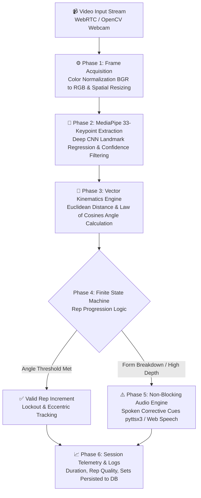

# 🏋️‍♂️ Apna AI Gym Coach — Real-Time Computer Vision Workout Trainer

<div align="center">

[](https://ai-realtime-gym-coach-prashil.netlify.app/)
[](https://ai-realtime-gym-coach-prashil.streamlit.app/)
[](https://developers.google.com/mediapipe)
[](https://opencv.org/)
[](https://developer.mozilla.org/en-US/docs/Web/JavaScript)
[](LICENSE)

<br/>

**Your form. Analyzed. Corrected. In milliseconds. Zero wearables required.**  
*Powered by Google MediaPipe, OpenCV, vector kinematic calculations, and proactive non-blocking audio synthesis.*

<br/>

[🌐 Launch Live Website (Netlify)](https://ai-realtime-gym-coach-prashil.netlify.app/) • [🚀 Launch Streamlit App](https://ai-realtime-gym-coach-prashil.streamlit.app/) • [⚡ Test Web Simulator](#-interactive-biomechanical-simulator) • [📹 Watch Video Demo](#-video-demonstration) • [📐 Biomechanical Pipeline](#-system-architecture--vision-pipeline) • [👨‍💻 Developer](#-developer--connect)

<br/>


</div>

---

## 📌 Table of Contents

- [Overview](#-overview)
- [Key Features](#-key-features)
- [System Architecture & Vision Pipeline](#-system-architecture--vision-pipeline)
- [Biomechanical Trigonometry & Formulas](#-biomechanical-trigonometry--formulas)
- [Exercise Modalities Supported](#-exercise-modalities-supported)
- [Interactive Biomechanical Simulator](#-interactive-biomechanical-simulator)
- [Interface Gallery & Showcase](#-interface-gallery--showcase)
- [Comparison Matrix: AI Coach vs. Traditional Methods](#-comparison-matrix-ai-coach-vs-traditional-methods)
- [Video Demonstration](#-video-demonstration)
- [Tech Stack](#-tech-stack)
- [Project Directory Structure](#-project-directory-structure)
- [Quick Start Guide](#-quick-start-guide)
- [Roadmap](#-roadmap)
- [Developer & Connect](#-developer--connect)
- [License](#-license)

---

## 🌟 Overview

**Apna AI Gym Coach** is a real-time computer vision workout assistant and biomechanical form analyzer. Traditional gym training has significant drawbacks: checking your posture in a mirror requires turning your neck—which distorts spinal alignment under heavy loads—while hiring a certified personal trainer costs between $60 to $120 per hour.

Apna AI Gym Coach solves this by transforming any standard device webcam or smartphone camera into an intelligent, sub-60ms biomechanics coach:

- **No Wearables Needed**: Tracks body kinematics via optical computer vision without requiring fitness bands or body sensors.
- **Immediate Audio Feedback**: Delivers low-latency spoken corrections (*"DEPTH: TOO HIGH. Keep your back straight, don't lean forward"*) so athletes maintain forward gaze and neutral cervical spine.
- **Accurate Rep Counting**: Uses Finite State Machine (FSM) phase tracking to eliminate half-reps and momentum-assisted cheat counts.
- **Interactive Cyber Web Hub**: Features a responsive web simulator with HTML5 Canvas skeleton drawing, Web Audio API sound effects, and Web Speech API synthesis.

---

## ⚡ Key Features

| Feature | Description |
| :--- | :--- |
| **⚡ Sub-60ms Latency** | Optimized edge inference pipeline processing frames in real-time at 30–60 FPS. |
| **🦴 33-Node 3D Skeleton** | Tracks full kinetic chain coordinates $(x, y, z)$ via Google MediaPipe Pose. |
| **📐 Joint Angle Calculus** | Computes precise anatomical flexion and extension degrees using vector dot products. |
| **🗣️ Proactive Audio Cues** | Instant text-to-speech audio guidance before catastrophic form failure occurs. |
| **🔄 FSM Rep Counting** | Finite state machine tracking eccentric, turnaround, and concentric phases to prevent false reps. |
| **📊 Longitudinal Analytics** | Automated session logging tracking exercise types, rep counts, sets completed, and duration. |
| **🎛️ Workout Calibrator** | Configurable difficulty levels (Beginner, Intermediate, Elite) and target tempos (e.g. 3-1-1s). |
| **🔊 Cyber Audio Synthesizer** | Custom Web Audio API oscillator sound engine for an immersive futuristic interface experience. |

---

## 🏗️ System Architecture & Vision Pipeline

The application processes webcam video streams through a modular 6-phase computer vision pipeline:



### Detailed Pipeline Phases:

1. **Frame Acquisition (`OpenCV`)**: Captures video frames at native resolution, performs color space conversion ($BGR \rightarrow RGB$), and scales the feed for minimal latency.
2. **MediaPipe 33-Keypoint Extraction**: Deep convolutional neural network extracts 33 full-body anatomical landmark nodes in spatial coordinates $(x, y, z)$ with confidence scoring.
3. **Kinematic Angle Calculus**: Computes Euclidean angles across joint triples (e.g., Hip–Knee–Ankle, Shoulder–Elbow–Wrist) using vector dot products.
4. **Finite State Machine (FSM)**: Manages discrete exercise states (`Standing` $\rightarrow$ `Eccentric Descent` $\rightarrow$ `Peak Contraction / Parallel Depth` $\rightarrow$ `Concentric Ascent` $\rightarrow$ `Lockout`). Prevents double-counting or counting half-reps.
5. **Non-Blocking Audio Synthesis**: Background multi-threaded speech engine alerts the athlete with proactive form cues without stalling the video render loop.
6. **Session Telemetry & History**: Logs workout metrics (exercise modality, sets, reps, timestamps, elapsed time) to local session memory.

---

## 📐 Biomechanical Trigonometry & Formulas

Joint angles are dynamically calculated across three connected spatial landmarks $A(x_1, y_1)$, $B(x_2, y_2)$ (the vertex), and $C(x_3, y_3)$:

$$\mathbf{u} = \vec{BA} = (x_1 - x_2, y_1 - y_2)$$

$$\mathbf{v} = \vec{BC} = (x_3 - x_2, y_3 - y_2)$$

The interior angle $\theta$ at joint vertex $B$ is derived using the vector dot product:

$$\cos(\theta) = \frac{\mathbf{u} \cdot \mathbf{v}}{\|\mathbf{u}\| \|\mathbf{v}\|} = \frac{(x_1 - x_2)(x_3 - x_2) + (y_1 - y_2)(y_3 - y_2)}{\sqrt{(x_1 - x_2)^2 + (y_1 - y_2)^2} \cdot \sqrt{(x_3 - x_2)^2 + (y_3 - y_2)^2}}$$

$$\theta = \arccos\left(\text{clamp}\left(\frac{\mathbf{u} \cdot \mathbf{v}}{\|\mathbf{u}\| \|\mathbf{v}\|}, -1.0, 1.0\right)\right) \times \frac{180^\circ}{\pi}$$

### Angle Threshold Calibration Table:

| Exercise | Tracked Joint | Target Range (Optimal) | Warning Range | Critical Fault Range |
| :--- | :--- | :--- | :--- | :--- |
| **Squats** | Knee Flexion (Hip–Knee–Ankle) | **$80^\circ - 95^\circ$** (Parallel / Below) | **$96^\circ - 115^\circ$** (Shallow) | **$> 115^\circ$** (Half-Rep / Incomplete) |
| **Bicep Curls** | Elbow Flexion (Shoulder–Elbow–Wrist) | **$45^\circ - 65^\circ$** (Full Squeeze) | **$66^\circ - 120^\circ$** (Mid-Range) | **$> 130^\circ$** (Starting Hang / Swing) |
| **Shoulder Press** | Elbow Extension & Overhead Lockout | **$165^\circ - 180^\circ$** (Full Lockout) | **$90^\circ - 140^\circ$** (Mid-Drive) | **$< 75^\circ$** (Excessive Flare) |
| **Deadlifts** | Hip Hinge & Spinal Alignment | **$15^\circ - 25^\circ$** (Hinge Plane) | **$26^\circ - 40^\circ$** (Hyperextension) | Spinal Curvature Detected |

---

## 🏋️‍♂️ Exercise Modalities Supported

### 1. Barbell & Bodyweight Squats
- **Depth Verification**: Validates whether the hip crease drops below or parallel to the knee joint.
- **Torso Lean Check**: Monitors spinal angle to prevent excessive forward trunk inclination (*"Good-morning squat"* fault).
- **Knee Cave Detection**: Observes frontal valgus collapse during concentric ascent.

### 2. Dumbbell Bicep Curls
- **Peak Contraction Check**: Verifies elbow flexion reaches $< 65^\circ$ for maximal bicep brachii tension.
- **Torso Swing Detection**: Tracks shoulder-to-hip sway to flag momentum cheating.
- **Eccentric Cadence**: Audio cues encourage a controlled negative descent.

### 3. Overhead Shoulder Press
- **Lockout Verification**: Detects full overhead elbow extension ($170^\circ - 180^\circ$) aligned with mid-foot.
- **Lumbar Arching Alert**: Flags excessive lumbar lordosis (leaning back to turn the press into an incline bench press).

---

## ⚡ Interactive Biomechanical Simulator

The included web portal features an interactive kinematics playground allowing users to test how the AI algorithm responds to joint angle variations:

- **Interactive Joint Slider**: Drag to adjust joint flexion from $60^\circ$ to $180^\circ$.
- **Real-time Canvas Rendering**: Custom vector skeleton drawn dynamically on an HTML5 `<canvas>`.
- **Dynamic Status Badging**: Instant classification into `OPTIMAL FORM`, `TOO SHALLOW`, or `OVER-FLEXION`.
- **AI Voice Coach Simulation**: Built-in Web Speech API synthesizes realistic spoken coaching cues directly through browser audio.

---

## 📸 Interface Gallery & Showcase

<div align="center">

| Step 01: Setup & Planner | Step 02: Real-time Correction |
| :---: | :---: |
|  |  |
| *Configure exercises, sets, reps, and workout history* | *Instant visual and audio correction when depth is cut short* |

| Step 03: Lockout & Rep Completion | Step 04: User Authentication |
| :---: | :---: |
|  |  |
| *Verified 178° lockout with vocal encouragement* | *Personalized profile for session tracking* |

| Step 05: Chronological Workout History | Step 06: Bicep Curl Kinematics |
| :---: | :---: |
|  |  |
| *Detailed metrics: reps, sets, seconds, and timestamps* | *Elbow angle flexion and torso momentum stability tracking* |

</div>

---

## 🥊 Comparison Matrix: AI Coach vs. Traditional Methods

| Feature | 🏋️ Apna AI Gym Coach | 🪞 Gym Mirror | 👨‍🏫 Personal Trainer |
| :--- | :---: | :---: | :---: |
| **Cost per Session** | **100% Free** | Free | $60 – $120 / Hour |
| **Degree Angle Accuracy** | **Exact ($\pm 2^\circ$) Readout** | ❌ Visual Guesswork | ❌ Visual Approximation |
| **Feedback Latency** | **Instant ($< 60\text{ ms}$)** | ❌ None | ⚠️ Delayed |
| **Neck Alignment Safe** | **✅ Audio-First (Eyes Forward)** | ❌ Dangerous neck turning | ✅ Eyes forward |
| **Automated Rep Counter** | **✅ FSM Multi-phase Logic** | ❌ Manual memory | ⚠️ Human miscount |
| **History & Telemetry Logging**| **✅ Automated Session DB** | ❌ Manual notebook | ❌ Dependent on trainer |
| **Availability** | **24/7 on any laptop / phone** | Requires mirror wall | Requires booking schedule |

---

## 📹 Video Demonstration

A full demonstration video is bundled within the repository at [`videos/video.mp4`](./videos/video.mp4). The web application includes an integrated video player featuring:

- **Time-Coded Chapter Jumps**:
  - `[0:00]` Initialization & User Auth
  - `[0:15]` 33-Point Pose Landmark Tracking
  - `[0:30]` Depth Verification & Audio Warning
  - `[0:45]` Rep Completion & History Ledger
- **Variable Playback Speed**: Select between $0.75\times$, $1.0\times$, $1.25\times$, and $1.5\times$ speeds.

---

## 🛠️ Tech Stack

### Web Presentation Hub & Simulator
- **Hosting & Deployment**: Netlify ([ai-realtime-gym-coach-prashil.netlify.app](https://ai-realtime-gym-coach-prashil.netlify.app/))
- **Structure**: Semantic HTML5 with accessibility ARIA tags
- **Styling**: Modern Vanilla CSS3 (Cyber grid backgrounds, glassmorphism, responsive CSS Grid / Flexbox)
- **Logic & Graphics**: ES6+ JavaScript, HTML5 Canvas 2D API
- **Audio Engines**: Web Audio API (interactive UI frequency synthesizers), Web Speech API (`SpeechSynthesisUtterance`)
- **Typography**: Google Fonts (*Outfit*, *Plus Jakarta Sans*, *JetBrains Mono*, *Averta*)

### Computer Vision & ML Core (Streamlit Deployment)
- **Programming Language**: Python 3.9+
- **Pose Estimation**: Google MediaPipe Pose (BlazePose 33-keypoint detector)
- **Video Processing**: OpenCV (`cv2`)
- **Mathematical Computation**: NumPy
- **Speech Synthesis**: `pyttsx3` / WebRTC audio streaming
- **Application Framework**: Streamlit Cloud

---

## 📂 Project Directory Structure

```text
AI-Realtime-GYM-Coach-Web/
├── IMGs/                       # Production application screenshots
│   ├── i1.png                  # Workout Setup & Modality Configuration
│   ├── i2.png                  # Squat Live Detection Depth Warning
│   ├── i3.png                  # Full Lockout Rep Completion & Encouragement
│   ├── i4.png                  # User Authentication & Profile
│   ├── i5.png                  # Chronological Workout History Analytics
│   └── i6.png                  # Bicep Curl Telemetry & Torso Stability
├── fonts/                      # Custom typography assets
│   └── Averta.woff2            # Averta font package
├── videos/                     # Demo video showcase
│   └── video.mp4               # Full-length production walkthrough
├── index.html                  # Cyberpunk landing hub, simulator & architecture
├── style.css                   # Glassmorphic cyber design system & animations
├── script.js                   # Interactive Canvas visualizer, audio & quiz logic
└── README.md                   # Comprehensive project documentation
```

---

## 🚀 Quick Start Guide

### 1. Access the Live Website (Netlify)

The interactive web portal and biomechanical simulator is deployed and hosted live on Netlify:

👉 **[Launch Live Website: ai-realtime-gym-coach-prashil.netlify.app](https://ai-realtime-gym-coach-prashil.netlify.app/)**

---

### 2. View the Web Hub & Simulator Locally

No build tools or package managers are required! You can open the interface in any modern browser:

#### Option A: Direct Open
Simply double-click [`index.html`](./index.html) or open it with your favorite browser:
```bash
# On Windows (PowerShell)
Start-Process index.html

# On macOS
open index.html

# On Linux
xdg-open index.html
```

#### Option B: Local Web Server (Recommended)
Using Python's built-in HTTP server:
```bash
# Python 3
python -m http.server 8000
```
Then navigate to `http://localhost:8000` in your browser.

#### Option C: Node.js `npx serve`
```bash
npx serve .
```

---

### 3. Access the Live Computer Vision Web App (Streamlit Cloud)

The real-time camera coaching application is deployed and hosted live on Streamlit Cloud:

👉 **[Launch Live Coach: ai-realtime-gym-coach-prashil.streamlit.app](https://ai-realtime-gym-coach-prashil.streamlit.app/)**

---

## 🗺️ Roadmap

- [x] Multi-exercise tracking (Squats, Bicep Curls, Overhead Shoulder Press).
- [x] Vector dot product law of cosines angle calculation engine.
- [x] Finite State Machine (FSM) rep validation.
- [x] Non-blocking spoken audio form correction.
- [x] Interactive web simulation playground with synthetic joint manipulation.
- [ ] Multi-person tracking mode for group fitness classes.
- [ ] Barbell velocity tracking and kinematic barbell path analysis.
- [ ] Progressive Web App (PWA) with offline webcam support.
- [ ] Apple Watch & WearOS companion app for haptic vibration alerts.

---

## 👨‍💻 Developer & Connect

Engineered with passion by **Kagathara Prashil**. Open to collaborations in Machine Learning Engineering, Computer Vision development, and AI Product deployment.

<div align="left">

[](https://www.linkedin.com/in/prashilkumar-kagathara/)
[](https://github.com/PD1526Patel)
[](https://leetcode.com/u/PD_Patel_1526/)
[](mailto:kagatharaprashilkumar1526@gmail.com)

</div>

---

## 📄 License

This project is licensed under the [MIT License](LICENSE) — feel free to use, modify, and distribute it for personal and commercial fitness applications.

---

<div align="center">
  <sub>Built with ❤️, OpenCV, MediaPipe, and modern web technologies. Star ⭐ this repository if you found it helpful!</sub>
</div>
